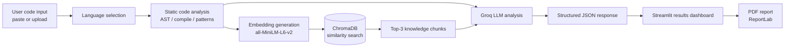
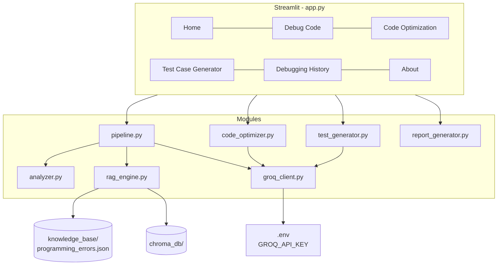
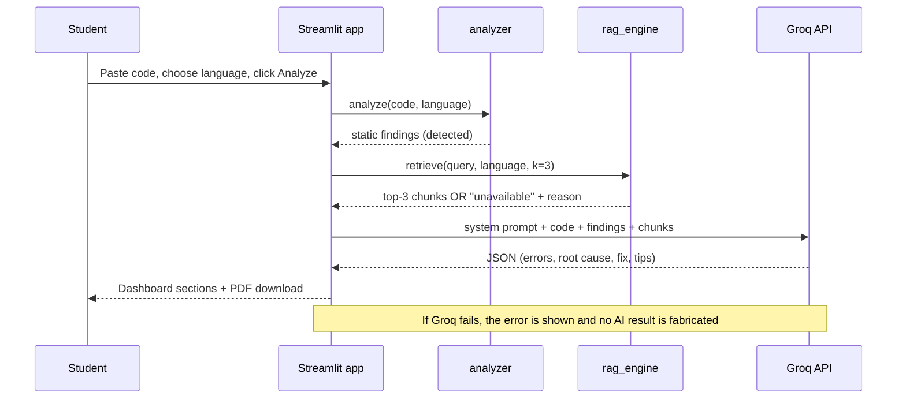

# BugLens AI - System Architecture

## 1. High-level pipeline



Static findings feed *both* the retrieval query and the LLM prompt, so the model starts from verified facts.

## 2. Component diagram



## 3. Request sequence (Debug Code page)



## 4. Modules

| File | Responsibility | Needs Groq key? |
|---|---|---|
| `config.py` | Paths, model names, `.env` loading | - |
| `modules/analyzer.py` | Python: `ast` + `compile()` + AST rules. Java/C/JS: masked-source pattern rules | No |
| `modules/rag_engine.py` | Embeds knowledge docs, stores/queries ChromaDB, reports availability | No |
| `modules/groq_client.py` | Groq calls, JSON parsing, error mapping, debug prompt | **Yes** |
| `modules/pipeline.py` | Orchestrates analyzer -> RAG -> Groq | Partly (AI step) |
| `modules/code_optimizer.py` | Loop-depth/recursion metrics + AI suggestions | AI part |
| `modules/test_generator.py` | AI-generated normal/edge/boundary tests | **Yes** |
| `modules/report_generator.py` | PDF with ReportLab | No |
| `app.py` | Streamlit UI, session state history | - |

## 5. Data structures

**Static finding**
```json
{"line": 1, "severity": "error|warning|info", "rule": "syntax-error",
 "message": "...", "method": "ast/compile | pattern"}
```

**Retrieval result**
```json
{"available": true, "reason": "OK",
 "chunks": [{"title": "...", "category": "...", "language": "...", "similarity": 0.61, "text": "..."}]}
```

**Debug record (one per code+language in the session)**
```json
{"id": 1, "timestamp": "...", "language": "Python", "code": "...",
 "static_findings": [], "retrieval": {}, "ai": {}, "ai_error": null,
 "optimization": null, "tests": null}
```

## 6. Design decisions

1. **Detected vs. suggested.** Static findings are labelled *Detected*; LLM-only `possible_bugs` are labelled *AI-suggested, not verified*.
2. **No fabrication.** Missing key, rate limit or bad JSON produces a visible error; the UI never substitutes canned AI output.
3. **Graceful RAG.** Heavy imports (`chromadb`, `sentence_transformers`) are lazy. If unavailable or the knowledge base is empty, the app says so and continues without retrieved context.
4. **Local embeddings.** Embeddings are computed locally and passed to ChromaDB explicitly, so no paid or remote embedding service is used.
5. **Language filter.** Retrieval is restricted to the selected language plus `General` documents.
6. **Free-tier friendly.** Code is truncated at 8000 characters and `max_tokens` is 2048 to stay within Groq free-tier token-per-minute limits.
7. **Session-only history.** History lives in `st.session_state` (no database, no stored user code on disk).
