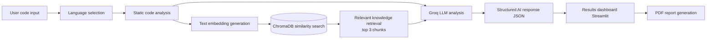
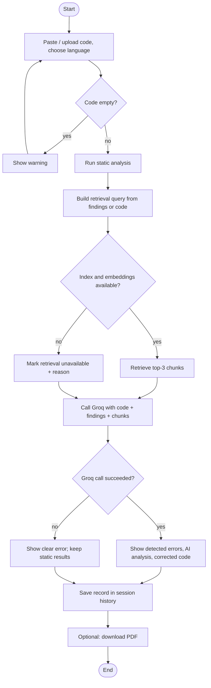

# BugLens AI: A Generative AI-Based Intelligent Code Debugging and Error Explanation System

**Mini Project Report**

| | |
|---|---|
| Team members | `[Name 1, Roll No.]`, `[Name 2, Roll No.]`, `[Name 3, Roll No.]` |
| Guide | `[Faculty name]` |
| Department / College | `[Department, College name]` |
| Academic year | `[Year]` |

> **Reading guide - measured vs. expected.** Throughout this report, anything marked **[MEASURED]** was produced by actually running code (the commands are given so you can repeat them). Anything marked **[EXPECTED]** is a design goal or hypothesis and has *not* been measured. Cells marked **`[TO BE MEASURED]`** are placeholders that the team must fill after running the full application on their own machine with a Groq API key. No accuracy percentage, speed figure or research result in this report has been invented.

---

## 1. Abstract

Students learning programming spend a large share of their time reading cryptic compiler messages and searching for the cause of a bug. Tools that simply output corrected code do not teach *why* the code failed. This project presents **BugLens AI**, a beginner-friendly web application that accepts source code (Python, Java, C or JavaScript), detects errors, explains their root cause in simple language, proposes corrected code, suggests optimisations and generates test cases.

BugLens AI combines three ideas: (1) **static analysis** (Python's `ast` module and `compile()` plus lightweight pattern rules for other languages) to produce *verified* findings; (2) **Retrieval-Augmented Generation (RAG)**, in which a small local programming knowledge base is embedded with the `all-MiniLM-L6-v2` Sentence Transformers model, stored in ChromaDB, and the top three relevant passages are retrieved for each query; and (3) a **large language model** served through the free tier of the Groq API, which receives the code, the verified findings and the retrieved passages and returns a structured explanation. Results are shown in a Streamlit dashboard and can be exported as a PDF report. The system clearly separates *detected* errors from *AI-suggested possible* bugs and never fabricates AI output when the API is unavailable.

In a small sanity test, the static-analysis layer produced the expected result on all 17 hand-written test cases and stayed silent on 4 valid programs **[MEASURED]**. End-to-end measurements of the AI layer (explanation quality, latency, retrieval relevance) are left as placeholders in Section 6 because they require a Groq API key and the full dependency stack.

**Keywords:** generative AI, code debugging, retrieval-augmented generation, static analysis, ChromaDB, Groq, Streamlit.

---

## 2. Introduction

### 2.1 Background
Beginners meet three kinds of problems: *syntax errors* (the program does not parse), *runtime errors* (the program crashes, e.g. `IndexError`) and *logic errors* (the program runs but gives wrong results). Compiler messages are written for experts; for example, "expected ':'" does not tell a beginner *why* the colon is needed. Large language models (LLMs) can explain code in natural language, but they can also give confident, incorrect answers (often called hallucinations), and they do not automatically know which facts about the code are verified.

### 2.2 Problem statement
There is a need for a free, easy-to-run assistant that helps students *understand* programming errors rather than only receiving corrected code, and that is honest about which findings are verified and which are only AI suggestions.

### 2.3 Objectives
1. Accept code in Python, Java, C and JavaScript by pasting or file upload.
2. Detect syntax errors and common mistakes using static analysis, and label them as *detected*.
3. Use an LLM (Groq free tier) to explain the root cause, point to the affected lines, and suggest corrected code and prevention tips.
4. Ground the LLM with a local RAG pipeline (ChromaDB + Sentence Transformers) that retrieves the top three relevant knowledge chunks.
5. Provide optimisation suggestions and test-case generation without inventing unverifiable claims.
6. Keep a session-based debugging history and export a PDF report.
7. Use only free/open-source components, and finish within a 3-4 hour development window.

### 2.4 Existing system
| Approach | Examples | Strengths | Weaknesses for learners |
|---|---|---|---|
| Compiler/interpreter messages | `python`, `javac`, `gcc` | Exact, free | Terse; no explanation of cause or fix |
| Linters / static analyzers | Pylint, Flake8, ESLint | Fast, deterministic | Rule-based; limited explanation; configuration needed |
| General AI chat assistants | Chat-based LLMs | Natural-language explanations | May hallucinate; no separation of verified vs. guessed; not grounded in a course knowledge base |
| Online judges | Many | Test-based feedback | Say *that* an answer is wrong, not *why* |

### 2.5 Proposed system
BugLens AI combines deterministic checks, retrieval from a curated knowledge base, and an LLM, and presents the output in separate sections: **Detected by static analysis**, **Retrieved knowledge**, **AI debugging analysis** (with a distinct *possible bugs - not verified* list), and downloadable reports. When the LLM is not reachable, the user sees a clear error and the static results remain available.

### 2.6 Scope and limitations of scope
Supported languages: Python, Java, C, JavaScript. Non-Python static checks are pattern-based (no compiler is invoked). History is session-only. The project is a prototype for learning, not a production code-review tool.

---

## 3. Literature Review

### 3.1 Static analysis
Static analysis inspects source code without executing it. Parsers build an abstract syntax tree (AST) that tools traverse to find syntax errors and suspicious constructs. Overviews can be found in Chess and West [1] and Louridas [2]. Python exposes its parser through the standard `ast` module and its compiler through `compile()` [8]; BugLens AI uses both for Python. For languages where no parser is bundled, tools commonly fall back on pattern rules; these are simple but can produce false positives and false negatives, which is why BugLens AI labels such findings with `method = pattern`.

### 3.2 LLM-based code assistants
Transformer models [3] trained on large text and code corpora can generate and explain code. Brown et al. [4] showed that large language models can perform many tasks from instructions or a few examples, and Chen et al. [5] evaluated models trained on code for program synthesis. Open-weight model families such as Llama [6] are available through inference providers including Groq [9]. A known risk is that LLMs can produce plausible but wrong statements, so their output should be treated as suggestions to be verified.

### 3.3 Retrieval-Augmented Generation
RAG, introduced by Lewis et al. [7], supplies a generator with passages retrieved from an external knowledge source so that answers can be informed by that source rather than only by model parameters. Retrieval typically uses dense vector representations: a sentence-embedding model such as Sentence-BERT [10] maps text to vectors, and similar texts have nearby vectors. A vector database (here ChromaDB [12]) stores the vectors and returns the nearest neighbours to a query.

### 3.4 Gap addressed by this project
Linters are precise but terse; chat assistants are expressive but unverified. BugLens AI is a small, free, student-friendly combination: verified findings from static analysis, curated context from RAG, and explanations from an LLM, with an explicit boundary between what was *detected* and what is only *suggested*. This report does not claim that BugLens AI outperforms any existing tool; no comparative study was performed.

---

## 4. Methodology

### 4.1 System architecture



### 4.2 Workflow



### 4.3 Static analysis module
**Python.** The code is parsed with `ast.parse()` and compiled with `compile()`. A `SyntaxError` (including `IndentationError` and `TabError`) is reported with its line number and Python's own message. If the code parses, AST rules look for: names used but never defined; calls to locally defined functions with the wrong number of arguments; `str + int` mismatches where types are obvious (literals and `input()` results); indexing a list or string literal with a constant out-of-range index; division by constant zero; `while` loops whose condition variables are never changed or `while True` without an exit; bare `except:`; mutable default arguments; and `is` comparisons with literals.

**Java, C, JavaScript.** Comments and string contents are masked, then regular-expression and bracket-matching rules are applied: unbalanced brackets, likely missing semicolons (C/Java), assignment inside `if`/`while` conditions, C `scanf` without `&`, unsafe `gets()`, missing `#include <stdio.h>`, array off-by-one loops (`i <= size`), Java `String ==` comparison, `system.out` typo, simple type mismatches, JavaScript `const` reassignment, and informational notes on `==` and `var`.

Each finding carries `line`, `severity`, `rule`, `message` and `method` (`ast/compile` or `pattern`).

### 4.4 Embeddings and ChromaDB
An **embedding** is a list of numbers (here 384 numbers) that represents the meaning of a text so that similar texts are close together. BugLens AI uses the free `all-MiniLM-L6-v2` model from Sentence Transformers [10, 11], run locally on the CPU.

**ChromaDB** [12] is an open-source vector database. The workflow is:

1. Read `knowledge_base/programming_errors.json` (37 documents in 9 categories **[MEASURED: file contents]**).
2. Embed each document (`title + content`) with the Sentence Transformers model.
3. Store ids, text, metadata (`language`, `category`, `title`) and vectors in a persistent ChromaDB collection (cosine distance) in `chroma_db/`.
4. For each query, embed the query, search the collection restricted to the selected language plus `General` documents, and return the top 3 chunks with their cosine similarity.

If the knowledge base is empty or the libraries are missing, `retrieve()` returns `available = False` with a reason, the UI shows a warning, and the LLM is told that no context is available.

### 4.5 LLM analysis (Groq)
The Groq API [9] is called through the official Python SDK. The API key is read from `.env` using `python-dotenv` and is never hardcoded. The default model is `llama-3.3-70b-versatile`; it can be changed with `GROQ_MODEL` because the list of free models changes over time. The system prompt requires JSON output with fixed keys (`summary`, `errors`, `possible_bugs`, `root_cause`, `affected_section`, `corrected_code`, `explanation`, `prevention_tips`), tells the model that static findings are verified facts while `possible_bugs` are its own suggestions, forbids inventing problems for correct code, and supplies the code with line numbers. Temperature is 0.2 to reduce randomness.

### 4.6 Anti-hallucination safeguards
- Verified (static) and unverified (AI) findings are displayed in different sections with different badges.
- If the API is unavailable (missing key, 401, 429, network, invalid JSON), an explicit message is displayed and no AI result is created.
- Optimisation and test-generation prompts instruct the model to give complexity estimates and expected outputs only when they can be determined, and otherwise to say "Cannot be determined".
- A UI notice reminds users to run and verify suggestions.

### 4.7 Other modules
- **Code optimisation:** verified metrics (lines of code, maximum loop nesting, recursion) are computed locally and passed to the LLM as hints.
- **Test generator:** produces normal, edge and boundary cases in a table.
- **History:** a list of records in `st.session_state`; lost when the session ends.
- **PDF report:** ReportLab produces a report containing code, detected errors, root cause, corrected code, explanation, optimisation and tests.

---

## 5. Experimental Setup

### 5.1 Hardware requirements
| Item | Minimum (expected) | Recommended |
|---|---|---|
| Processor | Dual-core x86-64 CPU | Quad-core CPU |
| RAM | 4 GB | 8 GB |
| Disk | About 3-5 GB free (Python packages incl. PyTorch, model cache) | 8 GB free |
| Network | Needed for first-time package/model download and for every Groq call | Stable broadband |
| GPU | Not required (embeddings run on CPU) | - |

These are planning estimates **[EXPECTED]**, not measured requirements. `[TO BE MEASURED: actual disk usage and RAM on the team's laptop]`.

### 5.2 Software requirements and technology stack
| Component | Technology | Purpose |
|---|---|---|
| Language | Python 3.10+ | Implementation |
| Frontend | Streamlit [13] | Dashboard and session state |
| LLM inference | Groq API (free tier) [9] | Explanations, fixes, tests |
| Vector database | ChromaDB [12] | Store and search knowledge embeddings |
| Embeddings | Sentence Transformers, `all-MiniLM-L6-v2` [10, 11] | Local text embeddings |
| Python analysis | `ast`, `compile()` [8] | Syntax and AST checks |
| Highlighting | Pygments [14] | Syntax-highlighted code |
| Tables | Pandas | Results tables |
| Reports | ReportLab [15] | PDF export |
| Configuration | python-dotenv | Read `.env` |
| OS used by team | Windows 10/11 `[confirm]` | Target platform |

### 5.3 Knowledge base
`knowledge_base/programming_errors.json` holds 37 short documents written for this project **[MEASURED: file contents]**: Python syntax errors, Python runtime errors, Java common errors, C programming errors, JavaScript common errors, loops and conditionals, functions and recursion, arrays and strings, and data types/type conversion. The documents were written by the project team from standard language behaviour and are not copied from a published dataset.

### 5.4 Test cases and evaluation methodology
Seventeen test programs are defined in `tests/sample_cases.py` and listed with results in `docs/test_cases.md`. They cover: missing colon, indentation error, undefined variable, type mismatch, index out of range, infinite loop, incorrect condition (Python, C and JavaScript variants), function argument mismatch, Java syntax error, Java string comparison, C `scanf` error, and four *negative controls* (valid Python, C, Java, JavaScript programs that must produce no findings).

Evaluation has two layers:

1. **Static layer (deterministic).** For each case, the test passes if every expected rule fires (or, for negative controls, no warning/error fires). Run `python tests/run_static_tests.py`.
2. **AI layer (needs Groq key).** `python tests/run_ai_tests.py` runs the full pipeline and stores the model's summary. Because language-model output varies, a **human reviewer** compares each answer with the expected behaviour and records PASS/FAIL manually (`docs/ai_verdicts.json`). Suggested rubric: (a) error identified correctly, (b) correct line, (c) corrected code runs, (d) explanation understandable to a beginner, (e) no invented problems.

Additional metrics defined for the team to measure `[TO BE MEASURED]`: response time per request (seconds), retrieval relevance (are the top-3 chunks relevant? judged manually 0-3 per chunk), and the number of invented problems on the negative controls.

### 5.4.1 Threats to validity
The sample set is small and hand-written, and the static rules were developed while looking at these cases; the results therefore show that the rules work as designed, not how well they generalise.

---

## 6. Results and Discussion

### 6.1 Sample input and output

**Input (Python):**
```python
def add(a, b)
    return a + b

print(add(2, 3))
```

**Detected by static analysis [MEASURED]** (actual output of `analyze()`):

| Line | Severity | Rule | Message | Method |
|---|---|---|---|---|
| 1 | error | syntax-error | SyntaxError: expected ':' | ast/compile |

**AI debugging analysis [EXPECTED FORMAT - illustrative, not a recorded model output]:** the model should (a) state that the function header on line 1 is missing a colon, (b) explain that Python uses the colon to mark the start of an indented block, (c) return the corrected code with `def add(a, b):`, and (d) give a prevention tip such as enabling editor syntax highlighting. `[TO BE MEASURED: paste the real screenshot/output from the running app here]`

### 6.2 Static analyzer results [MEASURED]
Measured in the development environment (Python 3.12.3, Linux) with `python tests/run_static_tests.py`:

| ID | Language | Case | Rule(s) that fired | Result |
|---|---|---|---|---|
| TC01 | Python | Missing colon | syntax-error | PASS |
| TC02 | Python | Indentation error | syntax-error | PASS |
| TC03 | Python | Undefined variable | undefined-name | PASS |
| TC04 | Python | Type mismatch | type-mismatch | PASS |
| TC05 | Python | Index out of range | index-out-of-range | PASS |
| TC06 | Python | Infinite loop | infinite-loop | PASS |
| TC07 | Python | `=` instead of `==` | syntax-error | PASS |
| TC08 | Python | Argument mismatch | argument-mismatch | PASS |
| TC09 | Java | Missing semicolon | missing-semicolon | PASS |
| TC10 | C | `scanf` without `&` | scanf-missing-address | PASS |
| TC11 | C | Off-by-one loop | off-by-one | PASS |
| TC12 | JavaScript | Assignment in condition | assignment-in-condition | PASS |
| TC13 | Java | `String ==` | string-equality | PASS |
| TC14-TC17 | Py/C/Java/JS | Valid programs (negative controls) | none | PASS |

Summary: **17 of 17** cases behaved as expected. In addition, `python tests/run_false_positive_probe.py` ran the analyzer on four longer, syntactically valid programs (Java, C, JavaScript, Python) with features that commonly confuse simple heuristics (multi-line expressions, comments and strings containing `;`/`{`, ternaries, `do/while`, `switch`); **4 of 4** produced no warnings or errors **[MEASURED]**. See `docs/test_cases.md` for the complete evaluation table with inputs.

### 6.3 AI layer results `[TO BE MEASURED]`
| Metric | Result |
|---|---|
| Cases where AI identified the error correctly | `[x / 13 buggy cases]` |
| Cases where the corrected code runs | `[x / 13]` |
| Invented problems on the 4 negative controls | `[x / 4]` |
| Retrieval: relevant chunks in top 3 (manual 0-3 score, mean) | `[x]` |
| Mean response time per request (s) | `[x]` |
| Groq model and date of test | `[model, date]` |

*Expected* (hypothesis, unmeasured): grounding the model with verified static findings and retrieved context should reduce vague or off-topic explanations for the common errors covered by the knowledge base. This should be tested by running the same cases with retrieval disabled and comparing manually `[TO BE MEASURED]`.

### 6.4 Observations from development [MEASURED unless stated]
1. **Order-insensitive name check.** In TC03 the analyzer flags the misspelled `totl` but does not flag `total = total + n`, where `total` is read before it is assigned. The check collects names defined anywhere in the file, so it avoids false alarms but misses use-before-assignment. This is documented in the test case; the AI step is expected to catch it `[TO BE MEASURED]`.
2. **Heuristics need negative tests.** The first version of the missing-semicolon rule was complicated; simplifying it and adding valid multi-line programs as negative controls showed that the simplified rule produced no false positives on the probe programs.
3. **Environment limitation.** The development sandbox had no internet access, so Streamlit, the Groq SDK, ChromaDB and Sentence Transformers could not be installed there. The following were tested for real: analyzer, optimizer metrics, PDF generation (output was rendered and visually inspected), the pipeline's error handling, and the knowledge-base file. The following were tested only with stand-ins/mocks: Groq request/response handling (JSON parsing, error-message mapping) and the Streamlit page functions (executed against a stub `streamlit` module). **Not tested at all in the development environment:** real Groq calls, real embeddings/ChromaDB retrieval, and real browser rendering of the Streamlit UI. These must be verified on the team's machine and recorded in Section 6.3.
4. **Pattern checks are advisory.** For Java/C/JavaScript, messages come from heuristics, not a compiler; the UI marks them accordingly.

### 6.5 Discussion
BugLens AI meets its design aim of separating verified findings from AI suggestions: the static layer is deterministic and fast, while the LLM provides the explanations a linter cannot. The approach is intentionally simple (a small knowledge base, regex-based checks for three languages), so coverage is limited to common beginner mistakes.

**Limitations**
- Non-Python static analysis is pattern-based and can miss errors or flag valid code.
- Logic errors (wrong algorithm, wrong output) cannot be found by the static layer; the AI may or may not notice them.
- LLM output can be wrong or inconsistent between runs; the user must verify.
- The knowledge base is small (37 documents) and hand-written.
- Groq free-tier limits (requests and tokens per minute/day) can interrupt use; model availability can change.
- Code is truncated at 8000 characters. History is lost when the session ends.
- PDF fonts are Latin-1, so non-Latin characters (e.g. Telugu or Hindi text in comments) appear as `?`.
- The code is sent to an external API (Groq); students should not submit confidential code.
- No code is ever executed by BugLens AI, so runtime behaviour is inferred, not observed.

**Future enhancements**
- Integrate real compilers/linters (`javac`, `gcc`, `eslint`) where installed.
- Run submitted code in a sandbox to capture real runtime errors.
- Expand the knowledge base and evaluate retrieval with a labelled query set; add hybrid keyword + vector search.
- Persist history (SQLite) and add user accounts.
- Add more languages and a "hint mode" that gives hints before the full fix.
- Evaluate with real students (learning gain, usability survey).
- Support Unicode fonts in PDF reports.

---

## 7. Conclusion

This project developed BugLens AI, a free and beginner-friendly debugging assistant that combines static analysis, a local RAG pipeline (Sentence Transformers + ChromaDB) and a Groq-hosted LLM behind a Streamlit dashboard, with session history and PDF export. Its main design principles are explanation over answers, a clear boundary between detected and AI-suggested findings, and honesty when components are unavailable. The static-analysis layer behaved as designed on all 17 sample cases and on four valid probe programs, while the end-to-end AI measurements are recorded as placeholders to be completed on the team's own machine. The work shows that a useful learning tool can be assembled from free components in a short time, and it provides a base for future work on compiler integration, sandboxed execution, a larger knowledge base and a study with real students.

---

## References

*Please verify author names, years and links against the original sources before final submission.*

1. B. Chess and J. West, *Secure Programming with Static Analysis*. Addison-Wesley, 2007.
2. P. Louridas, "Static code analysis," *IEEE Software*, vol. 23, no. 4, pp. 58-61, 2006.
3. A. Vaswani et al., "Attention Is All You Need," in *Advances in Neural Information Processing Systems (NeurIPS)*, 2017. arXiv:1706.03762.
4. T. Brown et al., "Language Models are Few-Shot Learners," in *NeurIPS*, 2020. arXiv:2005.14165.
5. M. Chen et al., "Evaluating Large Language Models Trained on Code," 2021. arXiv:2107.03374.
6. A. Dubey et al. (Llama Team, Meta), "The Llama 3 Herd of Models," 2024. arXiv:2407.21783.
7. P. Lewis et al., "Retrieval-Augmented Generation for Knowledge-Intensive NLP Tasks," in *NeurIPS*, 2020. arXiv:2005.11401.
8. Python Software Foundation, "`ast` - Abstract Syntax Trees" and "Built-in Functions: `compile`," Python 3 documentation. https://docs.python.org/3/library/ast.html
9. Groq, "GroqCloud Documentation" (API reference, models, rate limits). https://console.groq.com/docs
10. N. Reimers and I. Gurevych, "Sentence-BERT: Sentence Embeddings using Siamese BERT-Networks," in *EMNLP-IJCNLP*, 2019. arXiv:1908.10084.
11. Sentence Transformers documentation and `all-MiniLM-L6-v2` model card. https://www.sbert.net and https://huggingface.co/sentence-transformers/all-MiniLM-L6-v2
12. Chroma, "Chroma Documentation." https://docs.trychroma.com
13. Streamlit, "Streamlit Documentation." https://docs.streamlit.io
14. Pygments, "Pygments Documentation." https://pygments.org/docs/
15. ReportLab, "ReportLab Documentation (User Guide)." https://docs.reportlab.com
